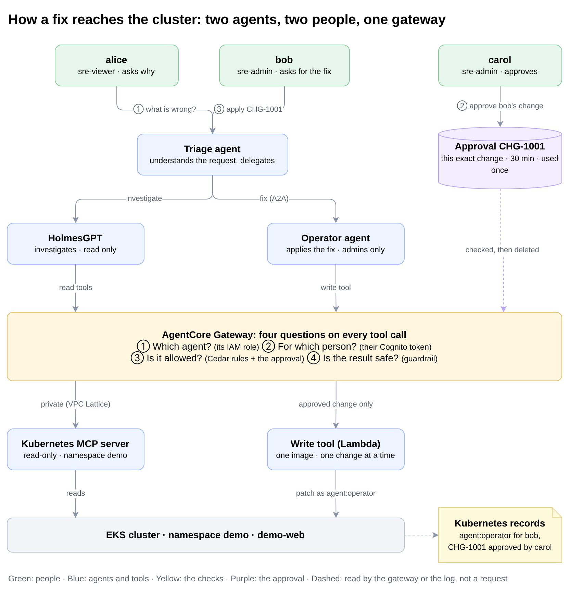

# AgentCore multi-agent security lab

A hands-on lab for securing a multi-agent SRE workflow on AWS with Amazon Bedrock AgentCore.

> **Status: configuration prepared, not yet run end to end.** See the [known gaps](docs/known-gaps.md).

This is project 3 of [Agentic Cyber Kit](https://agenticcyber.dev). Project 2 ran the same SRE scenario on a local kind cluster.

## Start here: the story

A bad image tag breaks `demo-web` on a small EKS cluster. Someone has also hidden instructions for the agents in an annotation on the Deployment. Three people and three agents deal with it:

1. **alice** (`sre-viewer`) asks what is wrong. The triage agent sends **HolmesGPT** to investigate. It can only read, and it finds the bad image. The hidden instructions are stopped at the gateway before HolmesGPT sees them.
2. alice asks for the fix. **Refused**: only an `sre-admin` can ask for a change.
3. **bob** (`sre-admin`) asks for the fix. **Refused**: nobody has approved it.
4. **carol**, a second `sre-admin`, approves exactly that change as `CHG-1001`.
5. bob asks again with `CHG-1001`. The **operator agent** changes one image in one Deployment. Kubernetes records that `agent:operator` did it for bob, and that carol approved it.

## The four questions

Every tool call from every agent goes through the AgentCore Gateway, and the gateway asks the same four questions. The agents' own code cannot skip them.

| Question | How the gateway answers it | What it stops in the story |
| --- | --- | --- |
| ① Which agent? | Each agent signs with its own IAM role. Cedar ties the agent's name to that role. | HolmesGPT pretending to be the operator |
| ② For which person? | The person's Cognito token travels with every call. The gateway checks its signature, its expiry and the person's group. | alice asking for a change; a forged or expired token |
| ③ Is it allowed? | Cedar rules (default deny) and, for a change, an approval by another `sre-admin` for exactly that change, used once. | bob changing without carol; any namespace but `demo`; any image but the approved one |
| ④ Is the result safe? | Every tool result goes through Bedrock Guardrails before the agent sees it. | The hidden instructions in the annotation |

Behind the gateway, Kubernetes adds its own limits: the read tools only see `demo`, never Secrets, and the write tool can change only `demo-web`.

## Try it

| You want to | Go to |
| --- | --- |
| Build the lab | [Setup guide](docs/setup.md): steps 0 to 13, each starting with what you will see |
| Watch the story run | `./scripts/demo.sh`, after the setup guide's step 8 |
| Try to get around the approval | `python3 scripts/checks.py approvals` (setup step 9) |
| See every component and control | [Architecture](docs/architecture.md) |
| Look up a term | [Glossary](docs/glossary.md) |
| Know what is not covered | [Known gaps](docs/known-gaps.md) |

## Cost

EKS, one t4g.small node, a NAT gateway, an internal ALB and six interface endpoints in two zones cost roughly $0.40 an hour while the lab runs, plus Bedrock model calls. Run `./scripts/teardown.sh` when you stop. The production-hardening items that would add cost are listed in the [known gaps](docs/known-gaps.md#would-add-infrastructure-cost).
