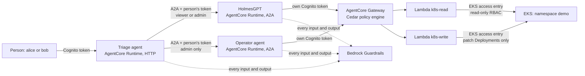

# AgentCore multi-agent security lab

A hands-on lab for securing a multi-agent SRE workflow on AWS with Amazon Bedrock AgentCore.

A **triage agent** receives a request from a person and delegates over A2A: **HolmesGPT** investigates a Kubernetes incident with read-only tools, and a separate **operator agent** applies the reviewed fix. Every hop has its own identity, every tool call is checked by Cedar policies at the AgentCore Gateway, and every agent runs its input and output through Bedrock Guardrails.

> **Status: configuration prepared, not yet run end to end.** Follow the [setup guide](docs/setup.md) and check the [known gaps](docs/known-gaps.md).

This is project 3 of [Agentic Cyber Kit](https://agenticcyber.dev). Project 2 ran the same SRE scenario on a local kind cluster.

## Scenario

A bad image tag breaks `demo-web` on a small EKS cluster. Someone has also added an annotation to the Deployment with hidden instructions for the agents.

1. **alice** (`sre-viewer`) asks the triage agent what is wrong. HolmesGPT reads the cluster through the gateway and finds the bad image. It also reads the hostile annotation, but it has no write tool, and Cedar forbids it from ever calling one.
2. alice asks for the fix. The triage agent tries to delegate to the operator, and **AgentCore refuses alice's token**: the operator only accepts `sre-admin`.
3. **bob** (`sre-admin`) asks for the fix. The operator changes one image in one Deployment, the only write its Cedar policy allows.

## Architecture



## Security controls

| Layer | Control |
| --- | --- |
| People | Cognito users in `sre-viewer` or `sre-admin`, 15-minute tokens |
| Delegation | Each runtime checks the person's `cognito:groups` claim before the request reaches the container. The operator accepts `sre-admin` only, so the triage agent cannot give a viewer more than a viewer may do. |
| Agents | HolmesGPT and the operator each have their own Cognito client and call tools with their own token. Their client secrets are in Secrets Manager, readable only by their own runtime role. |
| Tools | Cedar policies at the gateway, default deny: HolmesGPT reads `demo` only and can never call the write tool; the operator can change only the image of `demo-web` to an approved image. |
| Kubernetes | Each tool Lambda has its own IAM role mapped to its own Kubernetes group. RBAC makes the read Lambda read-only, even if a gateway policy were wrong. |
| Content | One Bedrock guardrail on every hop: prompt attacks blocked, AWS keys blocked, tokens, passwords and e-mails masked, destructive requests denied. Worker answers are checked as untrusted input. |
| HolmesGPT | Bash and built-in Kubernetes toolsets disabled. Its only view of the cluster is the gateway. |

## Repository layout

```
infra/       Terraform: VPC, EKS, Cognito, tool Lambdas, gateway, Cedar policies, guardrail, runtimes
agents/      triage, holmes and operator containers (ARM64), plus shared code in common/
manifests/   demo app and Kubernetes RBAC
scripts/     build and push, users, tokens, checks, teardown
docs/        setup guide and known gaps
```

## Cost

EKS, one t4g.small node and a NAT gateway cost roughly $0.20 an hour while the lab runs, plus Bedrock model calls. Run `./scripts/teardown.sh` when you stop.
