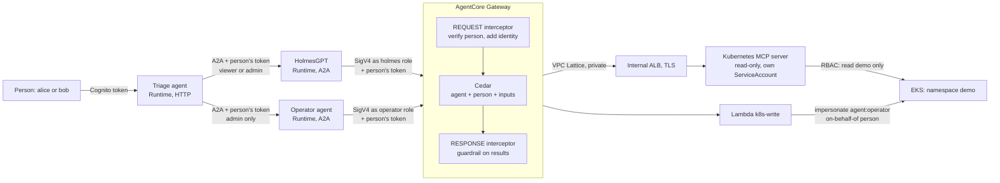

# AgentCore multi-agent security lab

A hands-on lab for securing a multi-agent SRE workflow on AWS with Amazon Bedrock AgentCore.

A **triage agent** receives a request from a person and delegates over A2A: **HolmesGPT** investigates a Kubernetes incident with read-only tools, and a separate **operator agent** applies the reviewed fix. Every tool call carries two identities, the agent and the person it acts for, and every layer checks them: the AgentCore runtime, the AgentCore Gateway, Cedar, and Kubernetes.

> **Status: configuration prepared, not yet run end to end.** Follow the [setup guide](docs/setup.md), see how [HolmesGPT reaches the cluster through the Kubernetes MCP server](docs/kubernetes-mcp.md), and check the [known gaps](docs/known-gaps.md).

This is project 3 of [Agentic Cyber Kit](https://agenticcyber.dev). Project 2 ran the same SRE scenario on a local kind cluster.

## Scenario

A bad image tag breaks `demo-web` on a small EKS cluster. Someone has also added an annotation to the Deployment with hidden instructions for the agents.

1. **alice** (`sre-viewer`) asks the triage agent what is wrong. HolmesGPT reads the cluster through the gateway and finds the bad image. The hostile annotation is stopped by the guardrail at the gateway before HolmesGPT sees it.
2. alice asks for the fix. **AgentCore refuses alice's token at the operator runtime**: the operator only accepts `sre-admin`.
3. **bob** (`sre-admin`) asks for the fix. The operator changes one image in one Deployment. The Kubernetes audit log records the change as `agent:operator`, on behalf of `bob`.

## Architecture



The three agents run inside the VPC and reach AWS only through VPC endpoints.

## Security controls

| Layer | Control |
| --- | --- |
| People | Cognito users in `sre-viewer` or `sre-admin`, 15-minute tokens, revocable with a global sign-out. |
| Delegation | Each runtime checks the person's `cognito:groups` claim before the request reaches the container. The operator accepts `sre-admin` only. |
| Agent identity | Each agent signs its gateway calls with its own IAM role (SigV4). No agent has a client secret. |
| On behalf of | The person's token travels with every tool call. The gateway's REQUEST interceptor checks it with Cognito (signature, expiry, sign-out), then writes the agent, the person and the person's role into the call. Agent code cannot set or change them. |
| Read tools | The upstream [Kubernetes MCP server](https://github.com/containers/kubernetes-mcp-server), read-only with a tool allowlist, behind the gateway as a private target (VPC Lattice to an internal ALB). Its ServiceAccount can read `demo` only, never Secrets. |
| Tools policy | Cedar policies, default deny: HolmesGPT and the operator read `demo` only, and only Pods, Deployments, ReplicaSets and Events; HolmesGPT never writes; the operator writes only for an `sre-admin`, only `demo-web`, only an approved image. |
| Content | The gateway's RESPONSE interceptor runs every tool result through Bedrock Guardrails, whatever the agent's code does. The agents also check what they receive from people and from each other. |
| Kubernetes | The write Lambda can only impersonate: every change runs as `agent:operator` with the person attached, and the audit log names both. Reads run as the MCP server's ServiceAccount. |
| Network | Runtimes in VPC mode, HTTPS only to VPC endpoints (Bedrock, AgentCore, Gateway, SSM, Logs, X-Ray). |
| State | Terraform state in an encrypted, versioned S3 bucket. It holds no secrets: agents use IAM roles and user passwords stay on your laptop. |
| HolmesGPT | Bash and built-in Kubernetes toolsets disabled. Its only view of the cluster is the gateway. |

## Repository layout

```
infra/       Terraform: VPC and endpoints, EKS, Cognito, MCP target (ALB, Lattice), write Lambda, gateway and interceptor, Cedar, guardrail, runtimes
deploy/      Kubernetes MCP server: Helm values, RBAC, NodePort and NetworkPolicy
agents/      triage, holmes and operator containers (ARM64), plus shared code in common/
manifests/   demo app and Kubernetes RBAC
scripts/     state bucket, build and push, users, tokens, checks, teardown
docs/        setup guide, Kubernetes MCP notes and known gaps
```

## Cost

EKS, one t4g.small node, a NAT gateway, an internal ALB and six interface endpoints in two zones cost roughly $0.40 an hour while the lab runs, plus Bedrock model calls. Run `./scripts/teardown.sh` when you stop.
