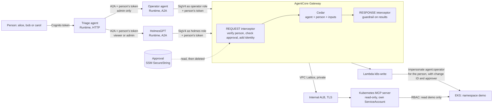
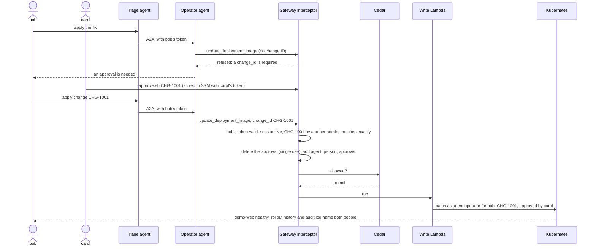

# Architecture in detail

Read the [README](../README.md) first: it tells the story with a simpler picture. This page has every component and every control.

## Components



The three agents run inside the VPC and reach AWS only through VPC endpoints. The README's diagram is [architecture.drawio](architecture.drawio) (AWS icons) and the story picture is [overview.drawio](overview.drawio); open either in draw.io to change it.

## Controls, by the gateway's four questions

### 1. Which agent is calling?

| Layer | Control |
| --- | --- |
| Agent identity | Each agent signs its gateway calls with its own IAM role (SigV4). No agent has a client secret. |
| Cedar | The agent name the request claims must match the IAM role that signed it. |

### 2. For which person?

| Layer | Control |
| --- | --- |
| People | Cognito users in `sre-viewer` or `sre-admin`, 5-minute tokens. |
| Delegation | Each runtime checks the person's `cognito:groups` claim before the request reaches the container. The operator accepts `sre-admin` only. |
| On behalf of | The person's token travels with every tool call. The gateway's REQUEST interceptor validates it (signature against the pool's keys, issuer, expiry, client); for changes it also checks the live session with Cognito, so a global sign-out stops changes at once. |

### 3. Is it allowed?

| Layer | Control |
| --- | --- |
| Changes | Four eyes: another `sre-admin` approves exactly that change (`scripts/approve.sh`), single use, 30 minutes at most. One change at a time. |
| Tools policy | Cedar, default deny: only HolmesGPT reads, `demo` only, and only Pods, Deployments, ReplicaSets and Events; HolmesGPT never writes; the operator has no reads and writes only for an `sre-admin`, with a change ID, only `demo-web`, only an approved image. |
| Read tools | The upstream [Kubernetes MCP server](https://github.com/containers/kubernetes-mcp-server), read-only with a tool allowlist, behind the gateway as a private target (VPC Lattice to an internal ALB). Its ServiceAccount can read `demo` only, never Secrets. See [kubernetes-mcp.md](kubernetes-mcp.md). |
| Kubernetes | The write Lambda can only impersonate: every change runs as `agent:operator`, with the person, the change ID and the approver attached. RBAC lets `agent:operator` patch `demo-web` and nothing else. |
| HolmesGPT | Bash and built-in Kubernetes toolsets disabled. Its only view of the cluster is the gateway. |

### 4. Is the result safe?

| Layer | Control |
| --- | --- |
| Content | The gateway's RESPONSE interceptor runs every tool result through Bedrock Guardrails, whatever the agent's code does: prompt attacks and AWS keys blocked, e-mails, tokens and passwords masked. The agents also check what they receive from people and from each other. |

### Around the four questions

| Layer | Control |
| --- | --- |
| Network | Runtimes in VPC mode, HTTPS only to VPC endpoints (Bedrock, AgentCore, Gateway, SSM, Logs, X-Ray). |
| State | Terraform state in an encrypted, versioned S3 bucket. It holds no secrets: agents use IAM roles and user passwords stay on your laptop. |
| Records | Each change is recorded three times: the interceptor log (who asked, who approved), the Kubernetes audit log (agent, person, change ID, approver) and the Deployment's rollout history. |
| Detection | Saved Logs Insights queries: denied calls, changes in order, writes with their approver, guardrail interventions, calls per person. |

## One change, step by step



## Repository layout

```
infra/       Terraform: VPC and endpoints, EKS, Cognito, MCP target (ALB, Lattice), write Lambda, gateway and interceptor, Cedar, guardrail, runtimes
deploy/      Kubernetes MCP server: Helm values, RBAC, NodePort and NetworkPolicy
agents/      triage, holmes and operator containers (ARM64), plus shared code in common/
manifests/   demo app and Kubernetes RBAC
scripts/     state bucket, build and push, users, tokens, approvals, demo, checks, teardown
docs/        diagrams (.drawio + .png), architecture, setup guide, glossary, Kubernetes MCP notes, known gaps
```
